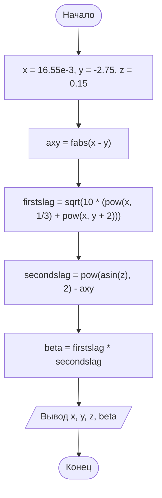

# Домашнее задание. Вычисление выражения (вариант 6)

## Условие задачи

Создать программу вычисления указанной величины. Результат проверить при заданных
исходных значениях.

Выражение (вариант 6):

$$\beta = \sqrt{10\left(\sqrt[3]{x} + x^{\,y+2}\right)} \cdot \left(\arcsin^2 z - |x - y|\right)$$

Контрольный пример: x = 16.55·10⁻³, y = −2.75, z = 0.15.

---

## 1. Разбор выражения

Выражение состоит из двух множителей:

1. **Корень** `sqrt(10 * (cbrt(x) + pow(x, y + 2)))`:
   - `cbrt(x)` — кубический корень из x;
   - `pow(x, y + 2)` — x в степени (y + 2);
   - обе части складываются, сумма умножается на 10, из результата берётся квадратный корень.
2. **Скобка** `asin(z)^2 - |x - y|`:
   - `asin(z)` — арксинус z (в радианах), его нужно возвести в квадрат: `asin(z) * asin(z)`;
   - `fabs(x - y)` — модуль разности x и y.

Результат β равен произведению этих двух множителей.

### Соответствие математических операций и функций языка C

| Математика | C (`math.h`) |
|---|---|
| квадратный корень | `sqrt(a)` |
| кубический корень | `cbrt(a)` |
| степень a^b | `pow(a, b)` |
| арксинус | `asin(a)` |
| модуль | `fabs(a)` |

### Область допустимых значений

- x > 0: при нецелой степени `y + 2` функция `pow` от отрицательного x не определена (получится `nan`);
- 10·(∛x + x^(y+2)) ≥ 0: под квадратным корнем не может быть отрицательное число;
- |z| ≤ 1: арксинус определён только на отрезке [−1; 1].

Контрольный пример этим условиям удовлетворяет.

---

## 2. Алгоритм и блок-схема

### Алгоритм

1. Объявить переменные типа `double` и задать исходные данные: `x = 16.55e-3`, `y = -2.75`, `z = 0.15`.
2. Вычислить модуль разности: `axy = fabs(x - y)`.
3. Вычислить первый множитель: `firstslag = sqrt(10.0 * (pow(x, 1 / 3.) + pow(x, y + 2.0)))`.
4. Вычислить вторую скобку: `secondslag = pow(asin(z), 2) - axy`.
5. Вычислить результат: `beta = firstslag * secondslag`.
6. Вывести `x`, `y`, `z` и `beta`.
7. Завершить программу.

### Блок-схема



---

## 3. Реализация программы

Исходный код находится в файле [Source.c](Source.c).

Для сборки с компилятором GCC нужна математическая библиотека: `gcc Source.c -o task6 -lm`.
В Visual Studio дополнительных настроек не требуется.

---

## 4. Проверка на контрольном примере

Исходные данные: x = 0.01655, y = −2.75, z = 0.15.

Ручной расчёт по шагам:

| Шаг | Вычисление | Значение |
|---|---|---|
| 1 | ∛x = ∛0.01655 | 0.254839 |
| 2 | y + 2 = −2.75 + 2 | −0.75 |
| 3 | x^(y+2) = 0.01655^(−0.75) | 21.672125 |
| 4 | ∛x + x^(y+2) | 21.926964 |
| 5 | 10 · 21.926964 | 219.269643 |
| 6 | √219.269643 (первый множитель) | 14.807756 |
| 7 | arcsin(0.15) | 0.150568 |
| 8 | arcsin²(0.15) | 0.022671 |
| 9 | \|x − y\| = \|0.01655 − (−2.75)\| | 2.76655 |
| 10 | 0.022671 − 2.76655 (вторая скобка) | −2.743879 |
| 11 | β = 14.807756 · (−2.743879) | −40.630694 |

Вывод программы:

```
x = 0.01655
y = -2.75
z = 0.15
beta = -40.630694
```

Результат программы совпадает с контрольным примером (40.630694) по цифрам.
Знак «минус» получается из-за того, что вторая скобка отрицательна:
arcsin²(z) ≈ 0.0227 намного меньше |x − y| ≈ 2.7666.

---

## 5. Информация о разработчике

- **ФИО:** Воротников Дмитрий Романович
- **Группа:** бОТИ-261
